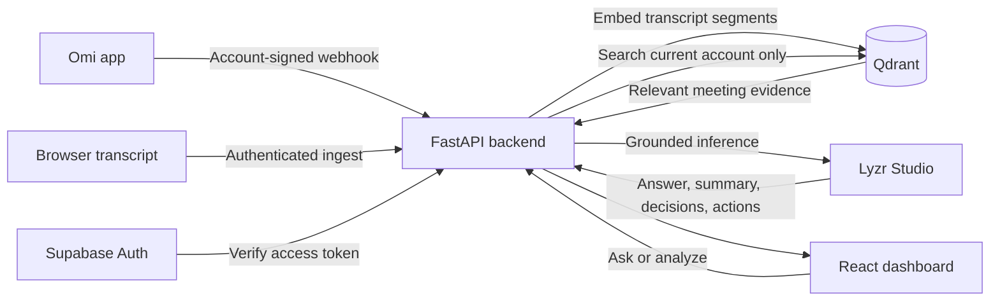

# OMIMIND

**Private meeting memory for Omi.** OMIMIND turns conversations into searchable context, meeting summaries, decisions, and action items. Ask a question later and get an answer grounded in what was actually captured.

| | |
|---|---|
| **Live app** | [omimind.vercel.app](https://omimind.vercel.app/) |
| **Source** | [masood-mashu/omimind-2.0](https://github.com/masood-mashu/omimind-2.0) |
| **Hackathon** | [HiDevs: Stop Prompting, Solo Agents](https://app.hidevs.xyz/hackathons/stop-prompting-solo-agents-hackathon-2026) |

## What it does

Omi captures conversations. OMIMIND stores transcript segments as private vector memories, then retrieves relevant passages before asking Lyzr to answer or analyze a meeting. Supabase Auth identifies the signed-in account, and every Qdrant read and search is scoped to that account.



## Judge quick start

You can explore the interface without setting up any integrations, or create an account to test the live pipeline.

### Option A: Explore the sample interface

1. Open the [live app](https://omimind.vercel.app/).
2. Choose **Explore the read-only demo**.
3. Review the sample Overview, Meetings, Action Items, and Memory screens.

The demo uses labeled sample data. It does not read or expose another account’s meetings, and its Lyzr Q&A and capture controls are disabled.

### Option B: Test a real private workspace

1. On the live app, create an account with an email address and password, then sign in.
2. Open **Live capture**. Paste this sample transcript and choose **Save to meeting memory**:

   > We decided to launch the beta on October 30. I will send the onboarding checklist by Thursday. If the support documents are not ready, we will delay customer invites.

3. Open **Meetings** and select **Analyze with Lyzr**. Review the summary, decision, and extracted action item.
4. Open **Ask your memory** and try:

   - “When did we decide to launch the beta?”
   - “What did I commit to sending, and by when?”
   - “What condition could delay customer invites?”

5. Ask something absent from the transcript, such as “What color was the office?” OMIMIND should say it could not find that information instead of inventing an answer.

Each account starts with its own private memory. A new account will not contain another account’s conversations; capture or connect a conversation in that account before testing live recall.

## Connect the Omi mobile app

Omi sends webhooks without a Supabase sign-in token. OMIMIND therefore creates signed webhook URLs for the currently signed-in OMIMIND account. **Each person must use the URLs shown in their own OMIMIND Settings.** The server verifies the signature and routes the event to that account’s Qdrant memory. It does not use the browser’s current login to route a later webhook.

1. Sign in to OMIMIND and open **Settings** using the account avatar or settings control.
2. Under **Omi webhook URLs for this account**, copy the **Conversation Events** URL.
3. In the Omi mobile app, open **Developer Settings → Webhooks**. Turn on **Conversation Events** and paste the copied URL into its **Endpoint URL** field.
4. Copy the **Real-time Transcript** URL from OMIMIND and paste it into Omi’s **Real-time Transcript** endpoint field. Turn that webhook on too.
5. Save the webhook settings in Omi, then record a short conversation. Check OMIMIND **Meetings** for the incoming conversation. Real-time transcript segments may appear while speaking; the completed conversation arrives when Omi finishes processing it.
6. Once the meeting appears, use **Analyze with Lyzr** or ask a question under **Ask your memory**.

Do not add a `uid` or `session_id` query string yourself. Omi appends its own webhook parameters. Keep each copied URL private: possession of a URL allows its holder to submit conversations to that account. If Omi is shared between evaluators, update the Omi endpoints to the URLs for the OMIMIND account being evaluated. If you do not have an Omi device available, use **Live capture** and paste a transcript instead.

### What happens to another user’s memories?

The webhook URL is signed for one Supabase user ID. The ID is covered by an HMAC signature, so changing the workspace ID invalidates the URL. Dashboard API requests independently verify the Supabase access token and apply that verified ID to Qdrant filters. Logging out and signing in as a different user changes the API identity and clears the previous user’s page state.

`OMI_WEBHOOK_TOKEN` is the server-only signing key. Rotating it invalidates all generated Omi URLs; each account must copy its new URLs into Omi. `OMI_WEBHOOK_UID` is optional and only retained to support an older single-user webhook URL during migration.

## Main screens

- **Overview:** recent meetings, open action items, memory moments, and integration status.
- **Meetings:** conversation archive and Lyzr meeting analysis.
- **Action items:** commitments captured from Omi or extracted during analysis.
- **Memory:** searchable transcript moments stored in Qdrant.
- **Live capture:** browser speech recognition or paste-in transcript ingestion.
- **Ask your memory:** semantic retrieval followed by a grounded Lyzr answer with supporting meeting context.
- **Settings:** account-specific Omi URLs and Omi, Qdrant, and Lyzr connection status.

## How answers stay grounded

For a question, FastAPI embeds the query, searches Qdrant using the authenticated account’s `uid` filter, and sends the matching transcript passages to the configured Lyzr agent. The prompt tells Lyzr to answer only from supplied meeting context, cite the meeting or speaker, and say when the context does not contain the answer. If Lyzr is unavailable or unconfigured, the API returns an error instead of substituting a mock answer.

Meeting analysis retrieves the selected meeting from the same account, asks Lyzr for a summary, decisions, and explicitly supported action items, then stores those results back under that account. Transcript contents are treated as untrusted data in the Lyzr instructions.

## Run locally

### Requirements

- Python 3.10 or newer
- Node.js 20 or newer
- Supabase project with Auth enabled
- Lyzr Studio API key and agent ID for live Q&A and analysis
- Qdrant Cloud for persistent hosted data, or local embedded Qdrant for development

The first embedding request downloads `BAAI/bge-small-en-v1.5` through FastEmbed.

### Setup

1. Copy the environment template and fill in the required values:

   ```powershell
   Copy-Item .env.example .env
   ```

2. Install dependencies from the project root:

   ```powershell
   py -3.11 -m venv .venv
   .\.venv\Scripts\Activate.ps1
   pip install -r server\requirements.txt
   npm install --prefix frontend
   ```

3. Start the FastAPI backend in one terminal:

   ```powershell
   uvicorn server.app:app --reload --port 8000
   ```

4. Start the React/Vite frontend in a second terminal:

   ```powershell
   npm run dev
   ```

5. Open the Vite URL printed in the terminal. The development proxy forwards `/api` and `/health` requests to `http://127.0.0.1:8000`.

Leave `QDRANT_URL` blank to use local storage at `QDRANT_PATH`. Local Qdrant data is for development; use Qdrant Cloud for deployed workspaces so memories survive instance replacement.

## Configuration

Set these values in the backend environment. Never put Lyzr, Qdrant, or Omi signing secrets in the Vercel frontend environment.

| Variable | Required | Purpose |
|---|---:|---|
| `SUPABASE_URL` | Yes | Supabase project URL used to verify sign-in sessions. |
| `SUPABASE_PUBLISHABLE_KEY` | Yes | Browser-safe Supabase Auth API key. Do not use a service-role key in the browser. |
| `OMI_WEBHOOK_TOKEN` | Yes for Omi | Long random server-only HMAC signing key for per-account Omi URLs. |
| `OMI_WEBHOOK_UID` | No | Legacy single-account webhook routing only. New Settings URLs do not use it. |
| `LYZR_API_KEY` | Yes for AI | Server-side key for Lyzr Studio inference. |
| `LYZR_AGENT_ID` | Yes for AI | Primary Lyzr agent ID used for grounded answers and analysis. |
| `LYZR_ACTION_EXTRACTOR_AGENT_ID` | No | Optional dedicated action-extraction agent. |
| `LYZR_MANAGED_AGENTS` | No | Optional JSON array of manager sub-agents; each entry has `id`, `name`, and `usage_description`. |
| `QDRANT_URL` | For hosted data | Qdrant Cloud cluster URL. Leave blank for local embedded Qdrant. |
| `QDRANT_API_KEY` | For Qdrant Cloud | Qdrant Cloud API key. |
| `QDRANT_COLLECTION` | No | Collection name; defaults to `omimind_meetings`. |
| `ALLOWED_ORIGINS` | For split hosting | Comma-separated frontend origins allowed by backend CORS. Include the exact Vercel URL. |

Optional tuning variables and defaults are listed in [.env.example](.env.example).

## Deploy

The current deployment layout separates the React frontend from the FastAPI backend. Omi webhooks must target the **public HTTPS backend URL**, not the frontend URL.

### Backend on Replit

1. Import the repository into Replit and use the included `.replit` deployment configuration.
2. Add the required backend variables from the table above in **Secrets**. Use Qdrant Cloud for durable deployed memory.
3. Set `ALLOWED_ORIGINS` to the exact deployed frontend origin, such as `https://your-project.vercel.app`.
4. Deploy/restart the backend and check `https://YOUR_BACKEND_HOST/health`. Confirm `status` is `ok`, `qdrant` is `connected`, and `auth_configured` and `lyzr_configured` are true. `omi_configured` should be true when `OMI_WEBHOOK_TOKEN` is set.

### Frontend on Vercel

1. Import the repository into Vercel with **Root Directory** set to `frontend`.
2. Set the Vercel environment variable `VITE_API_BASE_URL` to the public backend origin, for example `https://YOUR_BACKEND_HOST` (no trailing slash).
3. Deploy the frontend. Open the app, sign in, and check that Settings reports the backend integrations as ready.
4. Copy the account-specific Omi URLs from Settings into the Omi mobile app as described above.

Vite embeds `VITE_API_BASE_URL` at build time. Redeploy the frontend after changing that variable. Redeploy the backend after changing backend secrets or code.

## API reference

| Route | Access | Purpose |
|---|---|---|
| `GET /health` | Public | Service and integration configuration status; does not return secret values. |
| `GET /api/auth/config` | Public | Browser-safe Supabase URL and publishable key. |
| `GET /api/me` | Signed in | Return the verified Supabase user ID. |
| `GET /api/omi/webhook-config` | Signed in | Return Omi paths signed for the current account. |
| `POST /api/omi/conversation/{token}` | Omi signed URL | Ingest a completed Omi conversation. |
| `POST /api/omi/realtime/{token}` | Omi signed URL | Ingest Omi real-time transcript segments. |
| `GET /api/meetings` | Signed in | List this account’s meetings. |
| `GET /api/memories` | Signed in | List this account’s transcript moments. |
| `GET /api/actions` | Signed in | List this account’s action items. |
| `POST /api/ingest` | Signed in | Save a pasted or browser-captured transcript. |
| `POST /api/analyze` | Signed in | Analyze one of this account’s meetings with Lyzr. |
| `POST /api/ask` | Signed in | Search this account’s Qdrant memory and ask Lyzr. |

## Troubleshooting

| Symptom | Check |
|---|---|
| Sign-in or account creation fails | Confirm Supabase Auth is enabled and `SUPABASE_URL` and `SUPABASE_PUBLISHABLE_KEY` are set on the backend. |
| Settings says Omi is not ready | Set `OMI_WEBHOOK_TOKEN` in the backend Secrets and redeploy/restart the backend. |
| Omi conversation does not appear | Check both Omi webhook toggles, confirm each endpoint is the URL copied from the currently signed-in OMIMIND account, and verify Omi can reach the public HTTPS backend. |
| Meetings appear but Ask/Analyze fails | Check `LYZR_API_KEY`, `LYZR_AGENT_ID`, backend logs, and the Lyzr agent’s availability. |
| Qdrant reports not ready | Check `QDRANT_URL` and `QDRANT_API_KEY`, or confirm local disk storage is writable for development. |
| Browser requests fail only on the deployed frontend | Confirm `VITE_API_BASE_URL` is the backend origin and that the frontend origin is included in backend `ALLOWED_ORIGINS`. Then redeploy the frontend. |

## Privacy and current limitations

- Supabase access tokens are verified by the backend before user-specific API access. The server derives the Qdrant filter UID from the verified account, not a caller-supplied query parameter.
- Omi webhooks use account-bound signed URLs because Omi calls the backend without the user’s browser session. Each OMIMIND account must configure its own URLs in Omi.
- The read-only demo is sample content. It is separate from private Qdrant memories.
- Browser speech recognition may use the browser’s speech service. OMIMIND stores the resulting transcript, not browser microphone audio.
- Action-item completion toggles are saved in the current browser, scoped to the signed-in account; they are not yet synchronized across devices.
- Local embedded Qdrant storage may be ephemeral on hosted platforms. Use Qdrant Cloud for a persistent evaluation deployment.

## Project structure

```text
server/                 FastAPI routes, Supabase auth verification, Qdrant, and Lyzr calls
frontend/src/            React dashboard and browser API client
frontend/vite.config.ts  Local API proxy
.env.example             Backend configuration template
.replit                  Replit build and deployment commands
```
